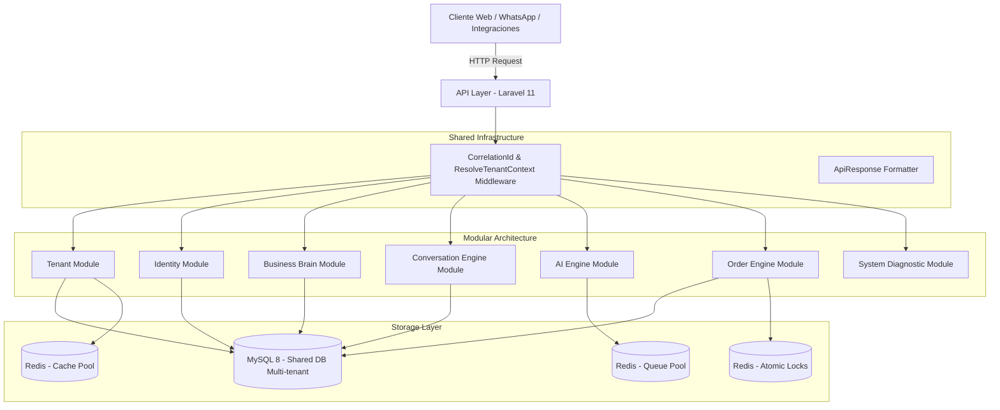

# 001 - Visión General del Sistema (System Overview)

## Arquitectura General de AIVA

AIVA es una plataforma SaaS multi-empresa dividida en capas desacopladas que utilizan la inteligencia artificial como una capacidad asistencial integrada a los módulos del negocio.

## Capas del Proyecto
1. **Core (`app/Core/`)**: Contratos, DTOs, Enums, EventBus, Excepciones, Traits (`BelongsToTenant`, `HasBinaryUuid`, `Auditable`).
2. **Application (`app/Application/` & `app/Modules/*/Application/`)**: Casos de uso aislados (Actions).
3. **Modules (`app/Modules/`)**: Funcionalidades de negocio agrupadas en dominios autónomos.
4. **Shared (`app/Shared/`)**: Middlewares de infraestructura y controladores globales.
