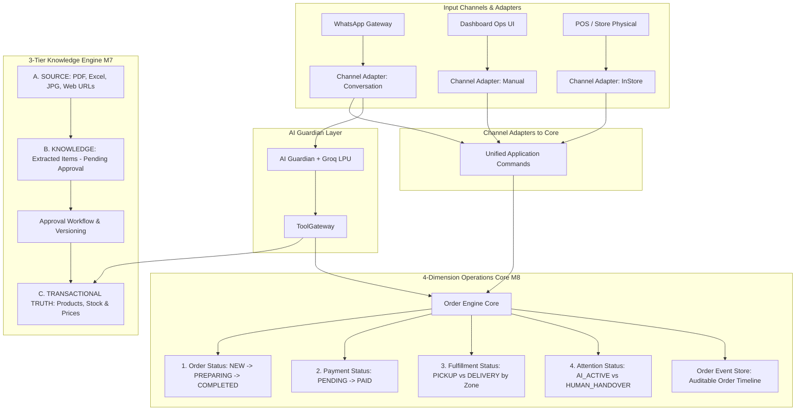

# Documento Oficial: AIVA v21.0 Business Operating System (BOS) — ARCHITECTURE FREEZE

## 📌 Declaración de Arquitectura Convalidada

AIVA se consagra oficialmente como el **Sistema Operativo Comercial (Business Operating System)** para PYMES. La Inteligencia Artificial opera como una interfaz de atención y ventas inteligente transversal, construida sobre la infraestructura congelada y blindada en las fases M1–M6.

---

## 🔒 Las 5 Reglas Inmutables de Arquitectura (Architecture Freeze)

1. **Regla #1 — Pipeline de 3 Capas (Source ➔ Knowledge ➔ Transactional Truth):**  
   - **Source:** Archivos/fuentes provistos (`menu.pdf`, `catalogo.xlsx`, URLs).
   - **Knowledge:** Extracción estructurada por IA con nivel de confianza (`confidence_score`). **NO VENDIBLE**.
   - **Transactional Truth:** Publicado en `products`, `product_variants`, `prices` e `inventory` únicamente tras la aprobación explícita del comerciante (`CatalogPublishingService`). Incluye versionado (`catalog_versions`).
2. **Regla #2 — Las 4 Dimensiones Independientes de Estado:**  
   - **Order:** `NEW`, `CONFIRMED`, `PREPARING`, `READY`, `COMPLETED`, `CANCELLED`.
   - **Payment:** `PENDING`, `PROCESSING`, `PAID`, `FAILED`, `REFUNDED`.
   - **Fulfillment:** `PENDING`, `PREPARING`, `READY`, `OUT_FOR_DELIVERY`, `DELIVERED`.
   - **Attention:** `AI_ACTIVE`, `HUMAN_HANDOVER`, `WAITING_CUSTOMER`, `WAITING_BUSINESS`, `RESOLVED` (perteneciente a `conversations`).
3. **Regla #3 — Event Store Inmutable de Pedidos (`order_events`):**  
   Línea de tiempo auditada registrando `actor_type` (`AI`, `HUMAN`, `SYSTEM`, `CUSTOMER`, `PAYMENT_PROVIDER`, `DELIVERY`).
4. **Regla #4 — Zonas de Delivery Estructuradas & Preparación para Rutas (`DeliveryBatch`):**  
   Costos, distritos y SLAs calculados por el Core desde `delivery_zones`. Estructura preparada para agrupamiento de rutas de reparto (`DeliveryRoute`).
5. **Regla #5 — Ningún Canal Crea su Propia Verdad Comercial:**  
   WhatsApp, Dashboard, POS, Web e Instagram utilizan adaptadores de canal (`Channel Adapters`) que convergen en los mismos comandos unificados del Core (`Unified Application Commands`).

---

## 🏗️ Diagrama de Arquitectura Oficial v21.0



---

## 🗺️ Hoja de Ruta Ejecutiva (Orden Secuencial M7 ➔ M8)

---

### 🔵 BLOQUE 1: Módulo M7 — Business Knowledge & Catalog Hub (M7.1 - M7.6)

#### [M7.1] Business Profile, Identity & Policies
##### [NEW] [2026_08_19_000070_create_business_profiles_table.php](file:///C:/xampp/htdocs/AIVA/app/Modules/Business/Database/Migrations/2026_08_19_000070_create_business_profiles_table.php)
- Tabla `business_profiles`: Identidad (Logo, Razón social, RUC, redes), Operación (Horarios, delivery, pedido mínimo) y Políticas (`business_policies` de cambios, devoluciones, reservas).
##### [NEW] [BusinessProfileService.php](file:///C:/xampp/htdocs/AIVA/app/Modules/Business/Services/BusinessProfileService.php)
- Servicio para la administración del perfil empresarial y políticas del negocio.

#### [M7.2] Business Sources & Assets Management
##### [NEW] [2026_08_19_000071_create_business_sources_table.php](file:///C:/xampp/htdocs/AIVA/app/Modules/Business/Database/Migrations/2026_08_19_000071_create_business_sources_table.php)
- Tabla `business_sources` (Capa A: SOURCE): Registro y almacenamiento de archivos (PDF, Excel, JPG, PNG) y URLs.

#### [M7.3] Knowledge Extraction Engine
##### [NEW] [2026_08_19_000072_create_knowledge_items_table.php](file:///C:/xampp/htdocs/AIVA/app/Modules/Business/Database/Migrations/2026_08_19_000072_create_knowledge_items_table.php)
- Tabla `knowledge_items` (Capa B: KNOWLEDGE): Borradores extraídos por IA (`detected_name`, `detected_price`, `confidence_score`, `status` = `PENDING_APPROVAL`).

#### [M7.4] Human Approval Workflow
##### [NEW] [KnowledgeApprovalService.php](file:///C:/xampp/htdocs/AIVA/app/Modules/Business/Services/KnowledgeApprovalService.php)
- Flujo de revisión y validación humana para aprobar o descartar borradores extraídos.

#### [M7.5] Catalog Publishing
##### [NEW] [CatalogPublishingService.php](file:///C:/xampp/htdocs/AIVA/app/Modules/Business/Services/CatalogPublishingService.php)
- Conversión de ítems aprobados a la Verdad Transaccional (`products`, `product_variants`, `prices`, `inventory`).

#### [M7.6] Catalog Versioning & Audit
##### [NEW] [2026_08_19_000073_create_catalog_versions_table.php](file:///C:/xampp/htdocs/AIVA/app/Modules/Business/Database/Migrations/2026_08_19_000073_create_catalog_versions_table.php)
- Registro e historial de versiones publicadas del catálogo transaccional.

---

### 🟢 BLOQUE 2: Módulo M8 — Operations Core & Central de Pedidos (M8.1 - M8.6)

#### [M8.1] Order Core & 4-Dimension State Machines
##### [MODIFY] [2026_08_06_000023_create_orders_table.php](file:///C:/xampp/htdocs/AIVA/app/Modules/Orders/Database/Migrations/2026_08_06_000023_create_orders_table.php)
- Ajuste de campos para las 4 máquinas de estado (`order_status`, `payment_status`, `fulfillment_status`, `attention_status`).

#### [M8.2] Order Event Store
##### [NEW] [2026_08_19_000080_create_order_events_table.php](file:///C:/xampp/htdocs/AIVA/app/Modules/Orders/Database/Migrations/2026_08_19_000080_create_order_events_table.php)
- Tabla `order_events`: Trazabilidad inmutable de línea de tiempo del pedido.

#### [M8.3] Delivery Zones & Structured Coverage
##### [NEW] [2026_08_19_000081_create_delivery_zones_table.php](file:///C:/xampp/htdocs/AIVA/app/Modules/Orders/Database/Migrations/2026_08_19_000081_create_delivery_zones_table.php)
- Tabla `delivery_zones`: Zonas, coberturas, tarifas de envío y SLAs por el Core.

#### [M8.4] Operational Alerts & Attention Required
##### [NEW] [OperationalAlertsService.php](file:///C:/xampp/htdocs/AIVA/app/Modules/Orders/Services/OperationalAlertsService.php)
- Motor de detección de alertas en tiempo real (`Atención Pendiente`, `Pagos Pendientes`, `Retrasos de Despacho`).

#### [M8.5] Operations Center & Dashboard UI
##### [NEW] [operations_center.blade.php](file:///C:/xampp/htdocs/AIVA/resources/views/operations_center.blade.php)
- Centro de Operaciones Unificado con alertas y Kanban.

#### [M8.6] Real-Time Event Stream
##### [NEW] [OrderEventDispatcher.php](file:///C:/xampp/htdocs/AIVA/app/Modules/Orders/Services/OrderEventDispatcher.php)
- Disparador de eventos en tiempo real hacia la interfaz.

---

## 🧪 Verification Plan

### Automated & Unit Verification
- Test de Aislamiento de Capa 3-Tier (Source ➔ Knowledge ➔ Transactional Truth):
  ```powershell
  C:\xampp\php\php.exe artisan test --filter=KnowledgePipelineIsolationTest
  ```
- Test de las 4 Máquinas de Estado & Trazabilidad `order_events`:
  ```powershell
  C:\xampp\php\php.exe artisan test --filter=OrderFourDimensionsTest
  ```
