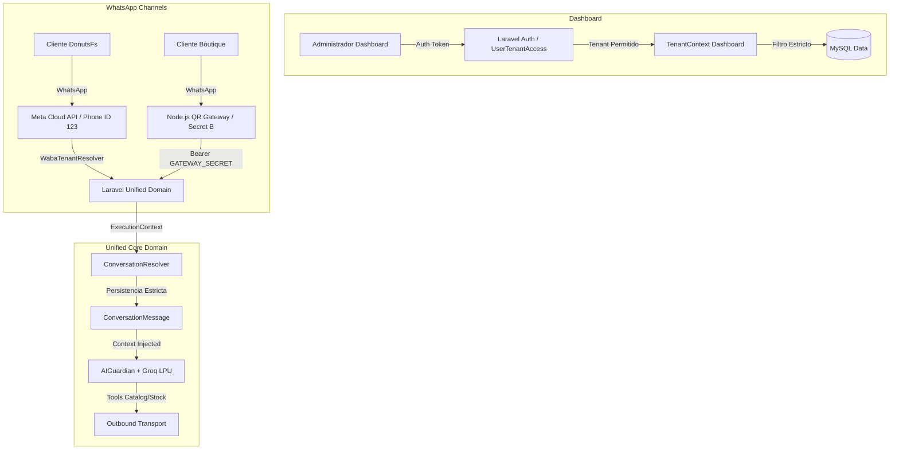

# Plan de Implementación Arquitectónico: AIVA Enterprise Multi-Tenant & WhatsApp Unified Domain (MT1 - MT8)

## 📌 Visión de Arquitectura

El principio fundamental que rige este sprint es:
> **"El Tenant NUNCA se determina por el mensaje del usuario, el LLM ni la UI del Dashboard. El Tenant proviene exclusivamente de la identidad de infraestructura verificada (Auth User Context / WhatsApp Connection / Gateway Secret)."**

---

## 🏗️ Diagrama de Arquitectura Unificada



---

## 🛑 Reglas Arquitectónicas Obligatorias

1. **Aislamiento de Tenant en Dashboard:**  
   `GET /api/v1/dashboard/conversations` NO acepta un `tenant_id` arbitrario en el query string. El controlador valida la pertenencia del usuario a través de `UserTenantAccess`. Intentar acceder a un tenant no autorizado devuelve `403 Forbidden`.
2. **Infraestructura WhatsApp Inmutable:**  
   El `tenant_id` de una conversación entrante por WhatsApp se resuelve mediante el canal de transporte:
   - **Meta Cloud API:** `phone_number_id` ➔ `whatsapp_connections` ➔ `tenant_id`.
   - **Node.js QR Gateway:** `GATEWAY_SECRET` ➔ `tenant_id` en Laravel API.
3. **Node.js como Adaptador Puro de Transporte:**  
   Node.js **NUNCA** escribe directamente en la BD MySQL. Toda interacción pasa por la API de Laravel: `Node.js Gateway` ➔ `POST /api/v1/messaging/qr-inbound` ➔ `Laravel Core`.
4. **Endpoint Protegido `tenant-brain`:**  
   El endpoint `/api/v1/messaging/tenant-brain` requiere encabezado `Authorization: Bearer GATEWAY_SECRET`. El secreto identifica de forma unívoca al Tenant y devuelve únicamente su catálogo y prompt.
5. **Métricas Enriquecidas en Metadata (`conversation_messages.metadata`):**  
   Se almacena `provider`, `model`, `latency_ms`, `tokens_input`, `tokens_output` y `tool_calls` para alimentar el cuadro de métricas del Dashboard.

---

## 🗺️ Hoja de Ruta del Sprint (Fases MT1 - MT8)

---

### [MT1] Tenant Context & Dashboard Selector Protegido
#### [NEW] [UserTenantAccessService.php](file:///C:/xampp/htdocs/AIVA/app/Modules/Tenant/Services/UserTenantAccessService.php)
- Servicio que valida si un usuario del Dashboard tiene permiso explícito sobre un `tenant_id`.
#### [MODIFY] [dashboard.blade.php](file:///C:/xampp/htdocs/AIVA/resources/views/dashboard.blade.php)
- Agregar el selector de empresa activa en el header superior. Al cambiar la empresa, invalida la sesión local del tenant y refresca métricas sin exponer IDs en el cliente.

---

### [MT2] Conversation API & Aislamiento de Dominio
#### [NEW] [ConversationDomainService.php](file:///C:/xampp/htdocs/AIVA/app/Modules/Messaging/Services/ConversationDomainService.php)
- Dominio centralizado de conversaciones. Garantiza que toda consulta a `conversations` y `conversation_messages` lleve la cláusula `WHERE tenant_id = ?`.
#### [NEW] [2026_08_18_000040_create_conversation_messages_table.php](file:///C:/xampp/htdocs/AIVA/app/Modules/Messaging/Database/Migrations/2026_08_18_000040_create_conversation_messages_table.php)
- Estructura optimizada para persistir mensajes con campo `metadata` en formato JSON (latencias de Groq, tokens, proveedor).

---

### [MT3] Dynamic Brain Context (Endpoint Protegido)
#### [NEW] [GatewayAuthMiddleware.php](file:///C:/xampp/htdocs/AIVA/app/Shared/Middleware/GatewayAuthMiddleware.php)
- Middleware que valida el token `Bearer GATEWAY_SECRET` enviado por los adaptadores de transporte y resuelve automáticamente el `tenant_id`.
#### [NEW] [TenantBrainController.php](file:///C:/xampp/htdocs/AIVA/app/Modules/Messaging/Controllers/TenantBrainController.php)
- Endpoint seguro `GET /api/v1/messaging/tenant-brain` que compila el Prompt del Sistema y el catálogo del Tenant autenticado.

---

### [MT4] WhatsApp Gateway Adapter (Cloud API + QR Gateway)
#### [MODIFY] [server.js](file:///C:/xampp/htdocs/AIVA/whatsapp-qr-gateway/server.js)
- Eliminar cualquier lógica de persistencia directa. `server.js` reenvía mensajes a `POST /api/v1/messaging/qr-inbound` con `GATEWAY_SECRET`.
#### [MODIFY] [WhatsAppWebhookController.php](file:///C:/xampp/htdocs/AIVA/app/Modules/Messaging/Controllers/WhatsAppWebhookController.php)
- Canalizar las notificaciones de Meta Cloud API hacia el mismo `ConversationDomainService`.

---

### [MT5] Dashboard Inbox & Conversaciones en Tiempo Real
#### [NEW] [DashboardConversationController.php](file:///C:/xampp/htdocs/AIVA/app/Modules/Messaging/Controllers/DashboardConversationController.php)
- Endpoints `/api/v1/dashboard/conversations` y `/api/v1/dashboard/conversations/{id}/messages` filtrados por Tenant autorizado.
#### [MODIFY] [dashboard.blade.php](file:///C:/xampp/htdocs/AIVA/resources/views/dashboard.blade.php)
- Panel Inbox interactivo con polling (2-3 segundos) para visualizar chats entrantes, burbujas de mensaje, latencia de Groq LPU y métricas acumuladas.

---

### [MT6] Human Handover & Intervención Manual
#### [NEW] [HandoverService.php](file:///C:/xampp/htdocs/AIVA/app/Modules/Messaging/Services/HandoverService.php)
- Lógica para conmutar el estado del chat (`PAUSED_HUMAN` vs `AI_ACTIVE`).
- Permitir al operador enviar mensajes manuales por WhatsApp desde el Dashboard.

---

### [MT7] Real-Time Performance & Metrics Engine
#### [NEW] [TenantMetricsCalculator.php](file:///C:/xampp/htdocs/AIVA/app/Modules/Messaging/Services/TenantMetricsCalculator.php)
- Servicio que calcula en milisegundos: Total Conversaciones, % Atendidas por IA, % Handover, Latencia promedio de Groq LPU, Total de Órdenes y Ventas (S/).

---

### [MT8] Reality Check: Test 17 — Multi-Tenant Isolation & Security
- Crear 3 Tenants de prueba en la base de datos:
  - **Tenant A (ID 4):** Pastelería Donuts Fs (Donas, Tortas, Café)
  - **Tenant B (ID 5):** Boutique Moda Elegante (Vestidos, Casacas, Zapatos)
  - **Tenant C (ID 6):** Clínica Dental OdontoSmile (Limpieza, Endodoncia, Ortodoncia)
- **Ejecutar Test 17:** Simular mensajes cruzados por API y verificar que AIVA sea físicamente incapaz de filtrar información o productos de otro Tenant.

---

## 🧪 Verification Plan

### Test Automatizado 17 (Multi-Tenant Isolation & Cross-Domain Security)
```powershell
C:\xampp\php\php.exe artisan test --filter=MultiTenantIsolationTest
```

### Verificación Manual de la Prueba Cruzada
1. **Intento de Acceso Ilegal por API:**
   - Realizar `GET /api/v1/dashboard/conversations?tenant_id=6` con una sesión autorizada únicamente para Tenant 4.
   - Confirmar que devuelva **`403 Forbidden`**.
2. **Inyección de Producto Cruzado:**
   - Enviar por WhatsApp el mensaje: *"¿Me puedes vender un vestido de la boutique?"* al número del Tenant 4 (Pastelería Donuts).
   - Verificar que AIVA responda: *"Pastelería Donuts Fs no vende prendas de vestir. Ofrecemos donas artesanales..."* sin mencionar jamás la existencia de la boutique.
